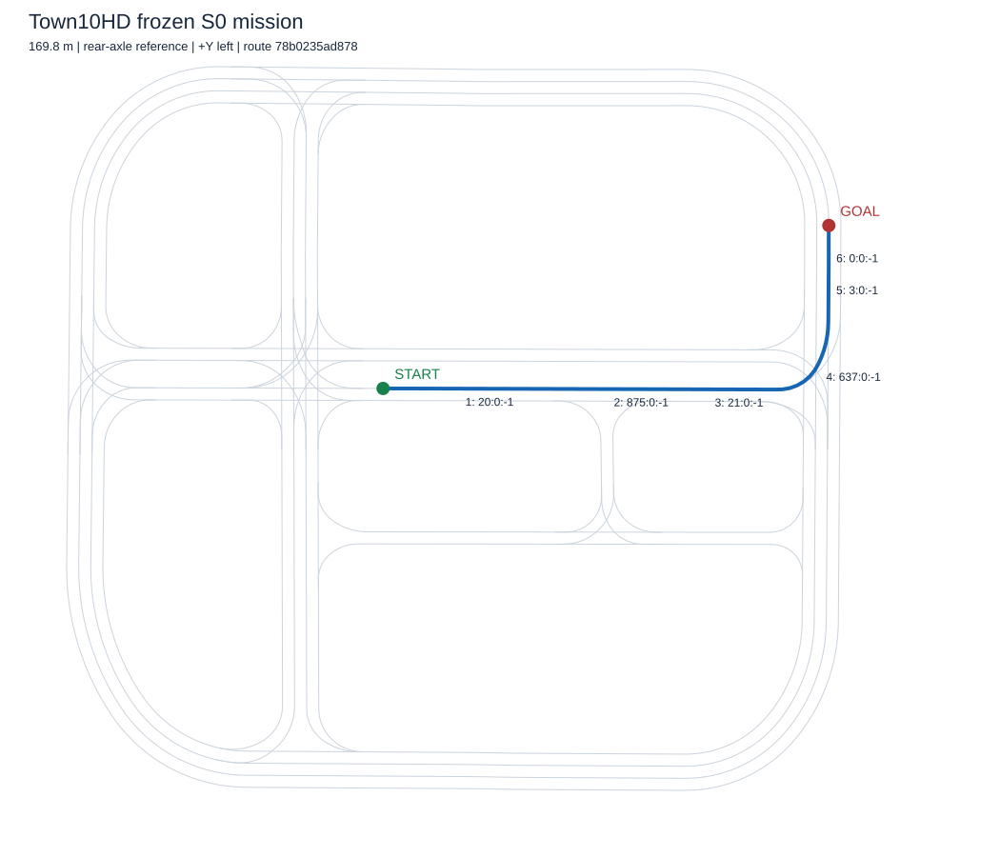

# Frozen Town10HD route (BL-A-04)

The mission uses one 169.81 m open, non-self-crossing rear-axle reference in
Town10HD / Town10HD_Opt. It travels straight through junction 841, turns left
through junction 532, and stops on the following straight. Traffic lights are
held green during S0 and restored after each episode.

The committed route is `configs/routes/town10hd_baseline_v1.json`; the execution
configuration is `configs/mission_baseline.json`. The exact legal section chain
is `20:0:-1 -> 875:0:-1 -> 21:0:-1 -> 637:0:-1 -> 3:0:-1 -> 0:0:-1`.
`point_slice` selects indices 3 through the end of the stitched topology, so
the vehicle starts inside a straight lane. The actor-origin spawn is offset
1.38641 m ahead of the first rear-axle waypoint and elevated 0.5 m for settling.
All serialized geometry uses right-handed +X forward, +Y left, +Z up metres;
the CARLA adapter converts Y and yaw signs at the boundary.

The loader verifies topology/OpenDRIVE identity, exact stitched geometry,
legal successors, open endpoints, geometric crossings/overlaps, spawn alignment
and goal identity. It returns detached metadata copies, so accidental caller
edits cannot change the executed route while retaining an old fingerprint.
Route and effective configuration hashes use canonical JSON. Loading never
queries the simulator or chooses a replacement route.

Validate without a simulator:

```powershell
python scripts/check_baseline_mission.py
python -m pytest -q tests/unit/test_baseline_mission.py
```

Validate against the installed OpenDRIVE file and regenerate the overlay:

```powershell
python scripts/check_baseline_mission.py --xodr D:/CARLA_0.9.16/CarlaUE4/Content/Carla/Maps/OpenDrive/Town10HD_Opt.xodr --overlay docs/evidence/TEST-02/route.svg
```

Use `--verify-map` instead of `--xodr` to query the running simulator. Geometry
validation is not driving acceptance. The selected route is frozen; speed
settings remain subject to measured tuning before the five-run suite.


