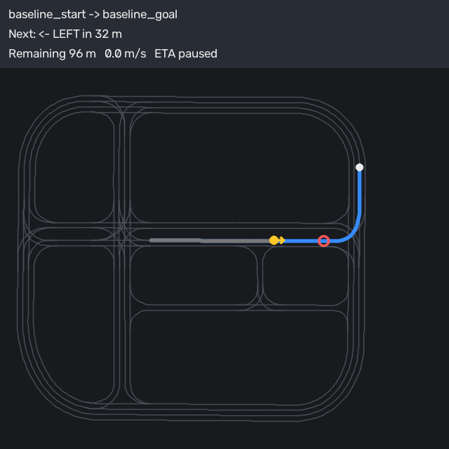

# E3 Wayfinder v1 offline replay evidence

Generated offline, without a simulator, from the checked-in Town10HD topology
fixture and the POI registry:

```powershell
python scripts/wayfinder_replay.py --origin baseline_start --destination baseline_goal --output docs/evidence/E3-wayfinder --frames 3
```

| File | Contents |
|---|---|
| `route.json` | Route-manager document: lane sequence `20:0:-1 → 875:0:-1 → 21:0:-1 → 637:0:-1 → 3:0:-1 → 0:0:-1`, point slice, 175.7 m polyline, manoeuvres (straight at junction 841, left at junction 532, arrive) |
| `guidance_log.json` | 97 guidance states at 0.5 s: progress, remaining distance, next manoeuvre and distance, ETA state; summary confirms monotonic progress and 8 paused steps |
| `frame_00.png` | Route start: next manoeuvre straight in 55 m, ETA 0:44 |
| `frame_01.png` | Scripted stop at 45 % of the route: speed 0.0 m/s, `ETA paused`, next left in 32 m |
| `frame_02.png` | Moving again at the same position, ETA restored |
| `frame_03.png` | Arrival at `baseline_goal` |



The lane sequence equals the frozen baseline route's `segment_ids`; the frozen
route is a slice of the same stitched polyline (`test_wayfinder_route.py`).
These frames are offline replay evidence; the live HUD screenshots required to
close the issue are recorded separately on CARLA.
