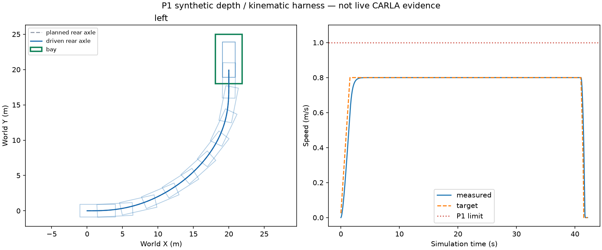
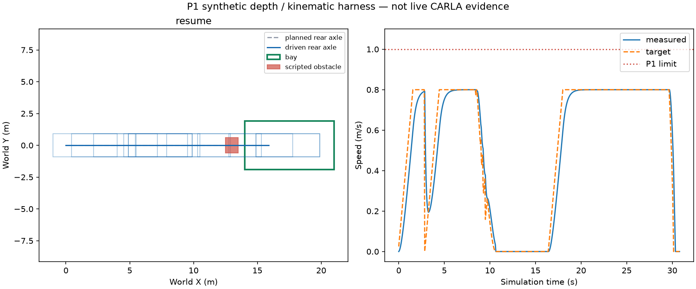

# P1 forward-parking evidence — E5-01 to E5-03

This record covers synthetic-depth, kinematic-harness execution only. Live
CARLA parking is **NOT RUN**; G1 admission is unchanged. See the
[interface and execution guide](../../parking.md) for assumptions and limits.

The acceptance runner retains every case, streamed control samples, immutable
plans, source/configuration hashes and summary metrics under `runs/P1/` and in
the `offline-p1-acceptance` CI artifact. Feature review was approved on PR #100; this evidence remains offline harness-scoped.

## Verified results — 25 October 2026

Code revision: `04180521d7b830d7e55cf717e0a1a4c99a285869`. The run was collected
before the local commits; every recorded core/config/runner source-byte hash was
subsequently checked against this revision's working files. The original dirty
run provenance is retained, not represented as a clean-commit execution.

Local raw batch: `runs/P1/20261025T030024289734Z`.
[Results](results.json), [source/artifact hashes](provenance.json) and
[full offline regression JUnit](regression.xml) are retained here. The raw batch
includes all eight attempts; no subset was selected to obtain acceptance.

| Case | Expected result | Final position error | Final heading error | Result |
|---|---|---|---|---|
| Straight | PARK once | 0.101445 m | 0 deg | PASS |
| Left turn | PARK once | 0.099784 m | 0.004137 deg | PASS |
| Right turn | PARK once | 0.099784 m | 0.004137 deg | PASS |
| Rotated world pose | PARK once | 0.099784 m | 0.004137 deg | PASS |
| Blocked bay | HOLD, no PARK | Not a completion attempt | 0 deg | PASS |
| Side obstruction | HOLD, no PARK | Not a completion attempt | 0 deg | PASS |
| Block then clear | HOLD, confirm, PARK once | 0.099288 m | 0 deg | PASS |
| Depth dropout | Brake while unknown, then PARK | 0.099214 m | 0 deg | PASS |

All cases remained at or below 0.8 m/s, with zero independently evaluated body
contacts and zero manoeuvring-area exits. Every successful parked body plus its
clearance margin fitted the bay. All plans installed once. Curved plans had a
maximum certified interval curvature of approximately 0.074823 /m, below the
0.121136 /m controller limit. CSV speed maxima and DRIVE-to-PARK transitions
were independently recalculated and matched the summaries.

Verification on the project Python 3.12 environment:

- **882 passed**, **1 live-CARLA test deselected**, **3 subtests passed** in the
  full offline suite, including 50 new P1 unit/integration cases.
- The 17 existing baseline evidence-review tests pass after the LF checkout fix.
- Existing five-trial offline S0 acceptance: **PASS**.
- Ruff and the AST/import simulator boundary: **PASS** (86 core modules).
- Sphinx HTML build with warnings treated as errors: **PASS**.
- Live CARLA parking, physical braking/steering validation at parking speed and
  front-camera near-field clearance qualification: **NOT RUN**.

## Retained trajectories

The body outlines illustrate the complete vehicle; dashed and solid lines are
the planned and driven rear-axle tracks. The blocked interval is visible in the
resume speed plot. These are synthetic sensor/kinematic results.





Reproduce using the project environment:

```powershell
.\.venv\Scripts\python.exe scripts/run_p1_acceptance.py --output runs/P1 --plots
.\.venv\Scripts\python.exe -m pytest tests/unit/test_parking.py tests/integration/test_parking.py
```
