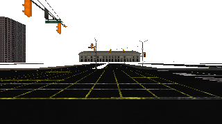
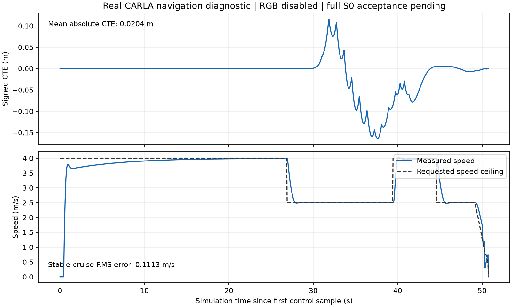
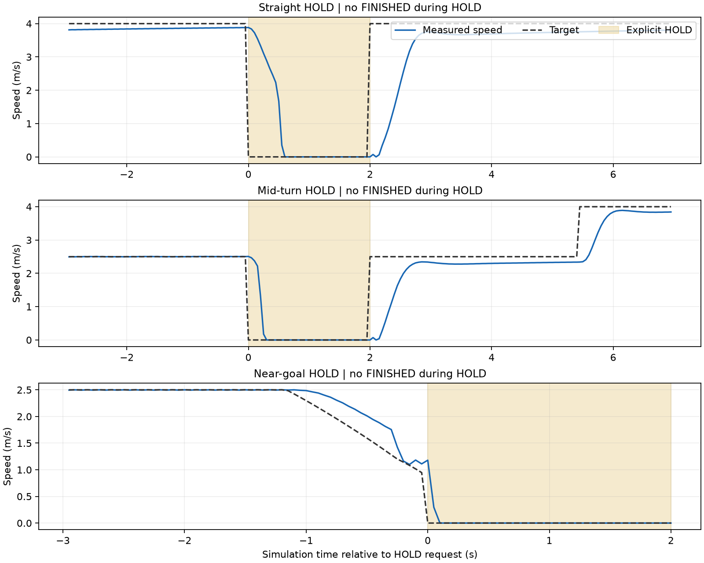

# TEST-02 navigation evidence

**Current result: five-run RGB-enabled S0 acceptance passed on the repaired
Windows runtime.** The original package's readback task-routing deadlock was
diagnosed using local PDB thread stacks. The final isolated runtime also enables
D3D11 immediate-context threading protection. It passed two complete five-run
suites and three RGB HOLD regressions in one uninterrupted server session.
This is navigation/S0 evidence; G1 approval remains a reviewer decision.
Earlier failed trials and the intermediate device-error runs are retained.

Current offline checks: **653 passed, 1 skipped**, including 106 legacy A1
test cases. Ruff and the simulator-boundary smoke check passed (64 core modules
imported with simulator imports blocked). The current JUnit report is
[retained separately](rgb-repair-regression.xml) from the historical report.
The current `sphinx-build -W docs docs/_build/html` build also passed.

Pre-repair author checks: **640 tests passed, 1 live-CARLA test deselected, and 3 subtests
passed**. Ruff passed; the simulator-boundary smoke check imported 64 core
modules with simulator imports blocked; the Sphinx documentation build passed
with warnings treated as errors. The actual driving diagnostics below are
separate from these offline checks.

## RGB repair and current acceptance

The validated machine is the Ryzen 5 5600H / RTX 3050 Laptop 4 GB / 16 GB
laptop, now using NVIDIA driver 617.42. Updating the driver alone did not
resolve the original five-frame camera stall.

The deployed repair has two parts: route readback tasks to an unnamed worker
instead of StatsThread, and protect the D3D11 immediate context used by the
rendering/readback threads. The native guard log confirms protection changed
from disabled to enabled. No navigation/controller settings, metric limits or
frozen input files were changed. The route SHA256 remains
`78b0235ad8788d03101bc027dfefa0f6bc6b89e309e4192ed3121742e14df06a` and
the configuration SHA256 remains
`bb87140f121390f4abf6c995093fc0cc45ee4ce939ee7888ce2efb618c0ae7b9`.

All five runs in each passing suite used fresh world episodes, completed the
mission, installed the route once, verified cleanup and retained real RGB
timing evidence. Earlier task-only and RHI-only trials were separate diagnostic
experiments; their failures were not omitted from a five-run suite.

The reproducible builder's final runtime passed another complete five-run
suite, `packaged-acceptance`, after the two stability suites. The three final
profile suites contain 15 passing runs in total across two server sessions;
the primary acceptance cohort is the final five, without combining cohorts.

| Primary RGB cohort | Result / worst value | Frozen limit |
|---|---|---|
| Complete S0 runs | 5 / 5 PASS | 5 |
| Route completion | 100% in each run | 100% |
| Mean absolute CTE | 0.02045 m | <= 0.3 m |
| Cruise speed RMS error | 0.11126 m/s | <= 0.5 m/s |
| RGB callback receipt to control application, p95 | 16.0 ms | <= 100 ms |
| Collisions / unplanned lane invasions / false stops | 0 / 0 / 0 | 0 / 0 / 0 |
| Route installation / cleanup | Once per run / verified | Once / verified |

Each run retained 1,016 control samples and 1,026-1,027 RGB receipts. The latency
column measures the defined host callback-to-application interval, not the
entire GPU capture pipeline. The separate straight, curve and near-goal RGB
HOLD regressions each retained 40 held samples, reached zero speed, kept
throttle at zero and completed only after release. Straight/curve intentionally
fail the ordinary no-false-stop metric; all three lifecycle checks pass.

The independent camera probe advanced 300 ticks and received 299 images with
the expected pipeline delay. Its first valid image matched the original
server's first-image SHA256. The Low-quality image is retained below.

The original executable is preserved. The reproducible builder creates an
isolated runtime, verifies the exact supported executable hash, compiles the
local guard from source and shares the existing assets through junctions.
The tested result requires this repaired runtime; it does not establish that
the original executable or every other hardware/driver configuration works.
See [repair and startup instructions](../../carla_rgb_readback_fix.md).

Current detailed results and every preliminary failure are in
[the RGB repair report](rgb-repair-results.json). The newer
[RGB repair archive](rgb-repair-evidence.zip) retains the raw runs, capture
probe, thread stacks, source/instruction checks, build identity and GPU logs.
Its [SHA256 file](rgb-repair-evidence.sha256) is separate from the unchanged
historical archive below. Generated executables, DLLs and shared asset trees
are excluded from the archive and Git; their source/build hashes are retained.

## Frozen mission and measured navigation

The rear-axle route is 169.8057 m, follows six explicitly connected legal lane
sections, and includes a straight junction crossing, a left turn and a stop on
the following straight. Route identity:
`78b0235ad8788d03101bc027dfefa0f6bc6b89e309e4192ed3121742e14df06a`.

The installed OpenDRIVE audit checked 168 lanes, 3,234 samples and 200 successors;
maximum saved-point error was 0.0000155 m. This establishes map/geometry identity,
not driving acceptance.

| Final diagnostic | Completed | Mean absolute CTE | Cruise RMS error | Collisions / invasions | Cleanup |
|---|---|---|---|---|---|
| Navigation, RGB disabled | Yes | 0.02045 m | 0.11126 m/s | 0 / 0 | Verified |
| Straight explicit HOLD | Yes | 0.01994 m | 0.15136 m/s | 0 / 0 | Verified |
| Mid-turn explicit HOLD | Yes | 0.02143 m | 0.11765 m/s | 0 / 0 | Verified |
| Near-goal explicit HOLD | Yes | 0.02058 m | 0.11126 m/s | 0 / 0 | Verified |

Each final diagnostic loaded a new CARLA world episode, installed its route
once, retained monotonic progress, used unchanged source files, and restored
actor inventory, world timing, weather and traffic lights. These are actual
CARLA vehicle-physics trials on the user's Ryzen 5 5600H / RTX 3050 Laptop 4 GB /
16 GB machine. They are explicitly nonformal because RGB is disabled.

All three HOLD trials remained outside `FINISHED` throughout a two-second hold,
reached stopped speed and released without replacing/resetting the route.
Straight and mid-turn trials resumed driving. The near-goal trial entered
`FINISHED` only after hold release, once already inside the valid endpoint
window. Explicit holds outside that window intentionally fail S0's no-false-stop
metric; separate lifecycle checks pass. This verifies the mission/controller
boundary, not obstacle perception or a clearance governor.

## Controller settings and rationale

The retained controller is Pure Pursuit with a 4 m lookahead, 4 m/s cruise cap,
2.5 m/s curve cap, 15 m curve preview, public PID gains `kp=0.5`, `ki=0.08`,
`kd=0`, and endpoint deceleration 1.2 m/s². The measured vehicle geometry and
20-degree controller steering cap remain in use. Endpoint tolerance is 0.8 m;
stopped-speed threshold is 0.1 m/s.

The previous 5 m/s value was provisional, not a measured comparison trial.
The initial complete 4 m/s diagnostic met the CTE and speed criteria, so no
additional parameter search was justified. The traces retain transient turn
error and braking behavior. Camera-disabled timing cannot establish full-stack
real-time performance or sensor-to-command latency.

## User-run verification on 17 October 2026

The user repeated the live map audit, navigation diagnostic and three HOLD
regressions on the same minimum-configuration laptop. The map audit passed
with 168 lanes, 3,234 points and 200 successor connections checked. All four
driving diagnostics completed, installed the route exactly once and verified
cleanup, with zero collisions and zero unplanned lane invasions.

| Diagnostic | Mean absolute CTE (m) | Cruise RMS error (m/s) | Recorded status |
|---|---|---|---|
| Navigation | 0.02045 | 0.11126 | INSUFFICIENT_EVIDENCE |
| Straight HOLD | 0.01994 | 0.15136 | FAIL: one intentionally injected false stop |
| Curve HOLD | 0.02143 | 0.11765 | FAIL: one intentionally injected false stop |
| Near-goal HOLD | 0.02058 | 0.11126 | INSUFFICIENT_EVIDENCE |

Each HOLD contained 40 samples at a 0.05 s simulation step, reached zero
speed, kept throttle at zero and remained in `stopping` throughout the hold.
The straight and curve trials finished after release. The near-goal trial
released and finished at step 1047, with no earlier completion. RGB was
disabled in these four diagnostics; none is a formal S0 acceptance pass.

The local raw directories are under `runs/manual/20261017-103510/`:
`navigation`, `hold-straight-104018`, `hold-curve-103910` and
`hold-near-goal-104026`. These new raw directories remain ignored by Git and
are not included in the earlier evidence archive.

A separate RGB-enabled trial in `runs/manual/rgb-rhi-20261017-104814/` used
DX11, `-norhithread`, a 640x360 Low-quality window and the unchanged frozen
320x180 camera configuration. It received five camera frames before
`world.tick()` timed out after 10 seconds during camera warm-up. A subsequent
two-second server health check also timed out, leaving actor, timing and
environment cleanup unverified. The run is retained as `FAIL`, with
`completed=false` and `cleanup_ok=false`. Disabling the independent RHI
thread did not resolve the camera stall. The observed NVIDIA driver was
552.22. At that point a driver update had been proposed but not tested; the
subsequent 617.42 retest and source-level diagnosis are recorded above.

All five trials recorded the same execution source bundle SHA256:
`a8091160429ef37734c7f04a0f54aae70948fbdde00a5e8813cc1905dcae9ee4`.
Full five-run S0 acceptance was still open at the time of those diagnostics.

## Historical camera blocker and retained failures

- Default DX12 startup crashed in the NVIDIA driver / D3D12 stack.
- DX11 loaded Town10HD_Opt successfully. Offscreen and hidden-window camera
  trials received a few images and then timed out at a subsequent world tick.
- Disabling optional scenery reduced observed GPU memory from about 3,764 MiB
  to about 1,962 MiB, but did not resolve camera capture.
- An explicitly authorized visible window and a paced, project-independent
  synchronous probe reproduced the stall after five receipts.
- A project-independent asynchronous probe also stalled after a few receipts.
- The installed Vulkan launch exited with code 3.

Those observations did not establish the root cause. The later stack-level
diagnosis and isolated-runtime repair are recorded above. No drivers, simulator
installation files or system graphics settings were changed during the
original trials; the user subsequently installed driver 617.42.

The archive also retains the intentionally time-limited navigation smoke run
and an earlier mid-turn run whose light-restoration check failed. That failure
led to restoring/verifying cached light state through owned synchronous ticks;
the later curve proof passed cleanup. Failed artifacts were not overwritten.

## Files and reproducibility

- [Machine and renderer observations](environment.json)
- [Machine-readable results and every retained trial](results.json)
- [All raw trial folders, console output and independent camera probes](raw-evidence.zip)
- [Archive SHA256](raw-evidence.sha256)
- [Regression JUnit report](regression.xml)
- [Frozen route overlay](route.svg)
- [Exact execution and measurement commands](../../s0_navigation_validation.md)

The four proof directories are `navigation-proof`, `hold-straight-proof`,
`hold-curve-proof` and `hold-near-goal-proof` under the archive's `runs/S0/`.
Manifests include the effective configuration/hash for each diagnostic,
committed source revision, actual source hashes, world episode IDs and cleanup
details. HOLD/diagnostic overrides have distinct identities and cannot be
aggregated into formal acceptance.

Reproduction now uses the repaired runtime and the unchanged five-run command
from the execution guide. Retain every raw folder and evaluate each applicable
metric. Any route/control/configuration change requires another frozen suite.
The pending-status labels inside the frozen configuration are historical
freeze metadata; current acceptance is recorded externally to preserve its hash.

## Local review units

The work is split into focused local commits: `e951f4a` freezes the route,
`6848bce` adds lifecycle/HOLD completion gating, `535901f` adds metric evaluation,
and `36a63f7` adds S0 execution and acknowledged control evidence. Route,
lifecycle, and S0 tooling can be reviewed as three dependent groups; the last
group contains separate metric and simulator commits. Evidence is committed
separately. All authored code, comments, diagnostic messages and documentation
are English. AI assistance was used for implementation, review and test design;
human source review remains outstanding. Current live acceptance and the
separate server compatibility repair are documented above. Significant AI
interactions are recorded in the [AI journal](../../ai_journal.md).
