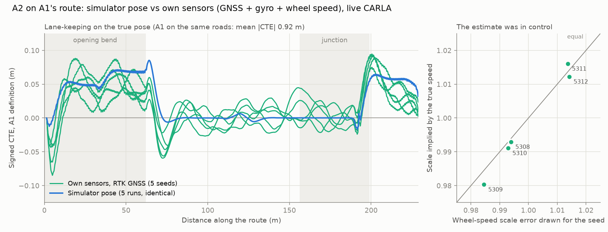

# A2 on A1's route without the simulator pose (RTK GNSS, live CARLA)

Date: 2026-10-21. A2 drove A1's TEST-01 route (`configs/missions/a1_test01.json`) on a
pose estimated from its own sensors:
- GNSS (RTK profile);
- gyro;
- wheel speed.

The simulator's vehicle pose was not given to the controller. See
`docs/shadow_localisation.md` for the sensors and the estimator.

- **Runs:**
  - five live navigation-only runs, seeds 5308-5312;
  - stage folder `Group7_batch35_Navigation_20261021_135247_090`;
  - options `-Localisation configs\localisation_rtk_gnss.json -DriveOnEstimate`.
- **S1 (car in the lane, hold, removal):** one full-stack run, seed 5308, folder
  `Group7_a1route_S1_estimate_rtk`.
- **Scoring:** CTE, distances, margins and collisions are all measured on the true
  pose. `manifest.json` records `pose_source: estimate`.
- **Same-road reference:** the simulator-pose runs in `../TEST-03-a1-route/`, with the
  same route, the same configuration and the same seeds.

## Lane-keeping

| A2 on A1's route | Mean \|CTE\| | p95 | Max | Distance driven |
|---|---|---|---|---|
| Simulator pose (5 runs, identical) | 0.025 m | 0.069 m | 0.085 m | 229.7 m |
| **Own sensors, RTK GNSS (5 seeds)** | **0.023-0.031 m** | 0.058-0.081 m | 0.095 m | 229.6-229.7 m |
| A1 (TEST-01) | 0.918 m | 1.73 m | 3.43 m | 226 m |

CTE uses A1's definition (`compare_runs.py`).

All five estimate runs reached the goal and stopped there, with a final speed of at most
0.006 m/s.

- On the straight (s = 80-155 m), the simulator-pose run is flat at zero. The estimate
  runs wander: mean 0.7-1.4 cm, at most 4.4 cm. The RTK fixes' 2 cm noise passes through
  the estimate into steering.
- On the bends, both stay within 10 cm.

## Was the estimate really in control?

**What would show it.** On the estimate, the speed controller holds the measured wheel
speed. That reading carries a scale error drawn once per seed (1σ 1%). If the car was
driving on its own sensors, its true speed should differ from the simulator-pose runs by
exactly that error, seed by seed.

**Result.** It does, to within 0.42% (`checks.json`, right-hand panel):

| Seed | Scale error drawn | Scale implied by true speed |
|---|---|---|
| 5308 | 0.9940 | 0.9929 |
| 5309 | 0.9845 | 0.9803 |
| 5310 | 0.9929 | 0.9911 |
| 5311 | 1.0137 | 1.0161 |
| 5312 | 1.0142 | 1.0122 |

On the simulator pose, the five runs agree to within 3 mm, because the world does not
depend on the seed. Here each seed drives differently, as it should.

## Stopping for a car in the lane (S1, seed 5308)

Every S1 threshold that applies passes:

| Metric | Threshold | Own sensors (RTK) | Baseline acceptance, simulator pose (baseline route) |
|---|---|---|---|
| Route completion | ≥ 1.0 | 1.00 | 1.00 |
| Collisions | = 0 | 0 | 0 |
| Unplanned lane invasions | = 0 | 0 | 0 |
| Cross-track mean | ≤ 0.30 m | 0.018 m | 0.025 m |
| Cruise speed RMS | ≤ 0.50 m/s | 0.033 m/s | 0.002 m/s |
| Capture-to-apply p95 | ≤ 100 ms | 47 ms | 47 ms |
| Stopped bumper margin | 2.5-6.0 m | 4.774 m | 4.596-4.611 m |
| HOLD max speed | ≤ 0.1 m/s | 0.0001 m/s | 0.0003-0.0005 m/s |
| Resume delay | report | 1.55 s | 1.55 s |

- **Cruise RMS is higher.** The controller holds the measured wheel speed, which reads
  0.6% low for seed 5308. The true cruise speed was therefore 4.828 m/s against a
  target of 4.8 m/s.
- **Pose error during S1** (estimate minus truth, while moving):
  - lateral: mean 0.009 m, p95 0.022 m;
  - along-route: p95 0.038 m;
  - yaw: p95 0.41°.

`S1_summary.json` is the run's summary.

## What this does not show

1. **RTK is the favourable case.** The profile has:
   - 2 cm Gaussian noise, no constant offset, no dropouts, no multipath, no float or
     fix changes;
   - a 5 Hz rate.

   It measures what the estimator and controller can do with a good position source. It
   does not show that a real RTK receiver in a city would deliver that.
2. **Ordinary (consumer) GNSS does not reach this.** Its constant offset of about 1 m is
   not observable from GNSS, gyro and wheel speed alone. In the harness, the car then
   drives up to 1.3 m off the lane centre and misses the goal. The camera lane
   correction is the next step (`docs/shadow_localisation.md`).
3. **Wheel speed is modelled.** CARLA has no wheel encoder, so wheel speed is the true
   speed through a seeded scale-and-noise model.
4. **Known start and map.** The estimator starts at the mission start, where the car is
   parked. It steers on the same map route as before. Only the ego pose source changed.
   Obstacle perception (detector, depth and tracks) is unchanged.
5. **Small sample.** One S1 run (seed 5308), on this route's straight (obstacle at
   s = 120 m). It is not a frozen acceptance run.

## Files

- `comparison.json`: `scripts/compare_runs.py` output for the five estimate runs (A1
  against A2).
- `checks.json` and `cte_estimate_vs_truth.png`: made by `plot_estimate_vs_truth.py`
  from the simulator-pose and estimate `compare_runs` folders.
- `S1_summary.json`: the S1 run's `summary.json`.
