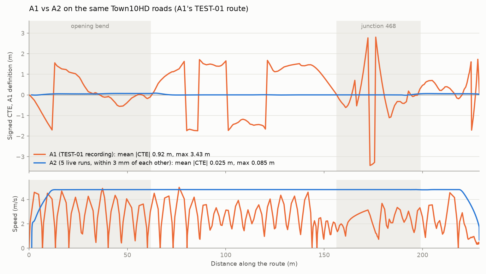

# TEST-03 on the same roads: A2 driving A1's TEST-01 route

Date: 2026-10-21. A2 drove `configs/missions/a1_test01.json`, the roads A1 took in its
TEST-01 recording (see `docs/a2_on_a1_route.md`). This removes the main caveat of the
first TEST-03 (`../TEST-03-a1-vs-a2/`), where A1 and A2 drove different roads.

- A1: committed TEST-01 capture, 258 moving samples over 226 m.
- A2: five live navigation-only runs, about 1008 moving samples each:
  - folder `Group7_batch35_Navigation_20261021_114645_235/runs/S0-01..05` under Downloads, seeds 5308-5312;
  - stage status `MEASURED_PASS_REVIEW_REQUIRED`.
- A2 configuration: the frozen baseline runtime, recovered and hash-verified
  (`../TEST-08-acceptance/frozen_runtime.json`): cruise 4.8 m/s, status PROVISIONAL.
- Route validated live: `MAP_GEOMETRY_VALIDATED` (RouteSetup, 21 Oct).

Files:
- `comparison.json` and `comparison.png`: `scripts/compare_runs.py` output.
- `cte_by_distance.png`: both drives on one distance axis, made by `plot_by_distance.py`
  from the same traces.

## Results

| Measure (moving samples, A1's CTE definition) | A1 | A2, five runs |
|---|---|---|
| Mean \|CTE\| | 0.918 m | 0.0250 m (0.02495-0.02503) |
| p95 \|CTE\| | 1.73 m | 0.069 m |
| Max \|CTE\| | 3.43 m | 0.085 m |
| Mean \|CTE\|, A2's own rear-axle route definition | n/a | 0.018 m (p95 0.048 m) |
| Loop cost p95 | 467 ms (cycle before apply) | 16 ms (capture to apply, one 15.6 ms clock tick) |
| Control period | 0.43 s mean, variable | 0.05 s fixed |
| Mean speed | 2.08 m/s, dropping below 0.5 m/s 14 times | 4.52 m/s, steady at the 4.8 m/s cruise |

At every sample the five A2 runs lie within 3 mm of each other. On the baseline route,
A2's mean on this definition was 0.036 m. That route spends half its length in a 90°
junction turn; this one spends 18%.

What the figure shows:
- **Lateral.** A1's CTE swings by ±1.5 m and jumps between signs where it changed lanes
  (lanes 1↔2 on roads 1 and 8). Through junction 468 it reaches 3.4 m. A2 stays within
  9 cm of its lane centre for the whole route, the bend and the junction included.
- **Speed.** A1 repeatedly slowed to near standstill and re-accelerated. A2 holds its
  cruise from about 12 m until it brakes for the goal.

## Differences that remain

The route difference is gone. These remain, and the first one carries most of the
lateral gap:

1. **Pose source.** A2 steers along a mapped route using the simulator's vehicle pose.
   A1 steered from camera lane estimates. The camera lane estimate is monitored in A2
   (RV-06) but not used for steering. On this route that monitor agreed with the map's
   curve direction in 97.5% of usable frames (median offset 6 cm, Quick S0-full and
   S1-full), against 22-26% on the baseline route's unmarked junction turn.
2. **Timing.** A2 is synchronous at 0.05 s; A1 was asynchronous at about 0.43 s.
3. **Speed.** A2 cruises at 4.8 m/s; A1 at 3 m/s (2.1 m/s average).
4. **Vehicle geometry.** A2 uses the measured Tesla Model 3; A1 used its demo's first
   blueprint match.
5. **Lane changes.** A1 changed lanes; A2 has no lane-change manoeuvre and keeps
   lane 1 / lane -1, which are A1's start and end lanes.

`compare_runs.py`'s fixed text still reads "Different roads are driven" and
"provisional 5 m/s". Both are fixed strings in the tool and are superseded here.
