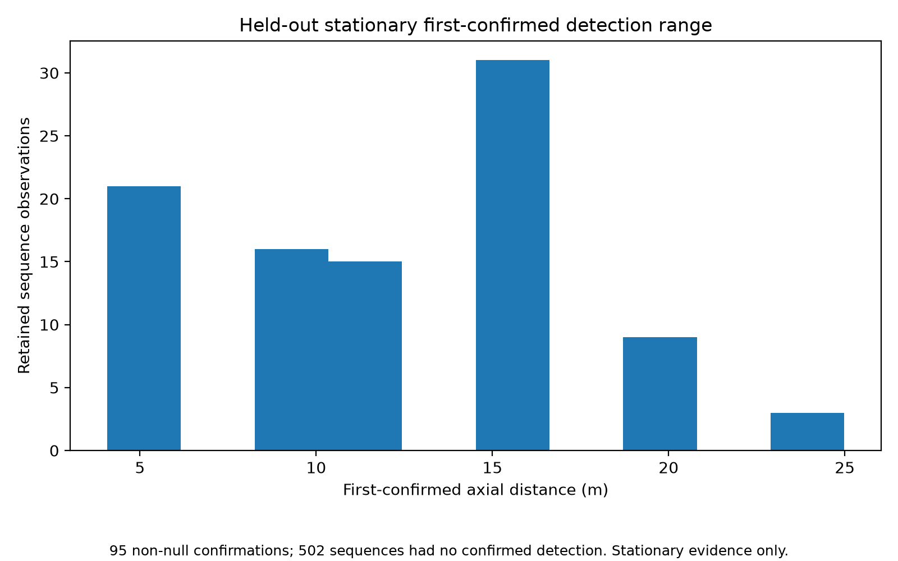

# TEST-09 held-out perception audit

This evidence package completes the held-out perception audit for issue #43 using retained outputs from the 1 November 2026 live capture. No CARLA recapture, detector retraining, parameter retuning, or learned inference was rerun for this package.

## Held-out dataset

The retained live matrix contains 27 cells with 600 frames per cell, for 16,200 captured frames in total.

The dataset was split into:

- 5,400 training frames
- 5,400 validation frames
- 5,400 held-out test frames

No detector tuning was applied to held-out test scenes.

## Perception metrics

The retained frozen-detector summary reports:

- Car precision: 0.69336
- Car recall: 0.14509
- Person precision: 0.96834
- Person recall: 0.64386
- Invalid-depth detections: 1,567

The low car recall is retained as a measured limitation and is not presented as evidence of detector robustness.

See:

- `metrics.json`
- `perception_precision_recall_range.png`

## First-confirmed detection range

The retained stationary held-out sequences contain:

- 95 non-null first-confirmed distances
- 502 null first-confirmed distances
- minimum retained non-null distance: 4.07 m
- maximum retained non-null distance: 24.99 m

A null first-confirmed distance means that no confirmed detection occurred in that retained sequence. These failures remain visible and are not silently discarded.

This range evidence applies only to stationary held-out sequences. It must not be interpreted as moving first-admission range, braking capability, stopping evidence, or proof of obstacle-stack robustness.

## Replay failure and correction evidence

The retained replay audit is included in:

`replay-table.md`

It reports per-sequence:

- class
- frame count
- recall
- valid-depth result
- confirmation timing
- first-confirmed axial distance
- ID switches

The replay audit states that no detector tuning was applied to test scenes. Existing canonical filter, freshness and HOLD behaviour was evaluated without inventing a new detector correction.

## Tracking continuity

The retained frozen-detector evidence contains 3 observed ID switches across the evaluated sequences.

These discontinuities remain visible in the evidence rather than being hidden by aggregate precision and recall.

## Safety and scope

Unknown or invalid depth and track loss remain fail-closed and cannot provide positive clearance or justify premature resume.

This package does not claim:

- detector robustness
- full semantic obstacle acceptance
- #40 autonomous CLEAR/RESUME support
- #41 normal target-induced obstacle acceptance
- PR #101 lane-monitor acceptance

The purpose of this package is to complete the held-out perception audit and preserve the measured limitations required by issue #43.

## Range figure

