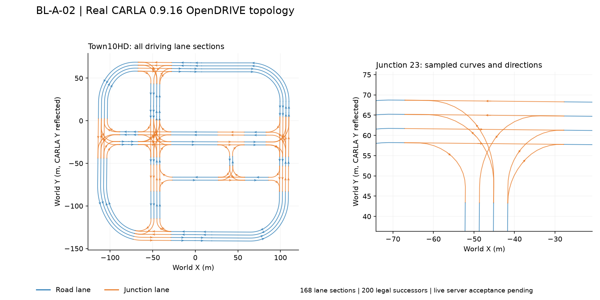

# Lane topology export — BL-A-02

Exports driving lane sections, legal successors, travel-order lane-centre
polylines and junction endpoints. This is the data prerequisite for BL-A-03
(junction planning) and E3-01 (A*), not an implementation of either planner.

## Data and compatibility

`planning.lane_graph.LaneTopology` is a frozen, simulator-independent map
document. Its JSON uses an adjacency-list representation: each `LaneSegment`
has `(road_id, section_id, lane_id)`, entry/exit OpenDRIVE `s`, XYZ samples,
`junction_id` and explicit `successor_ids`. Lane IDs alone are not globally
unique. Segment IDs are `road:section:lane`; endpoint node IDs append `:entry`
or `:exit`. A lane inside a junction carries that junction ID on the segment;
its entry and exit nodes retain the corresponding boundary positions.

`document.graph` builds the existing `autonomy.interfaces.LaneGraph` contract:
one directed polyline edge per lane section and one short directed edge for
each legal successor connection. The BL-F-01 types and constructor signatures
are unchanged. Separate endpoint identities preserve forks, merges and
parallel junction connectors. Geometrically close nodes are never merged:
merging them could authorize an unlisted turn or connect a bridge to the road
below it.

```python
from planning.lane_graph import LaneTopology

document = LaneTopology.load("tests/fixtures/Town10HD.lane_graph.json")
graph = document.graph  # pass this plain LaneGraph to the stack/planner
for lane in document.lanes:
    print(lane.segment_id, lane.successor_ids, lane.junction_id)
```

World coordinates are the existing right-handed project frame in metres:
`(CARLA x, -CARLA y, CARLA z)`. Graph polylines remain planar XY for the A1
controller; the document retains every sample's elevation. The configured
`navigation_speed_cap_mps` populates the required core edge speed field; it
is **not a CARLA traffic-sign or statutory speed-limit measurement**.

Schema version 1 records the normalized map name, OpenDRIVE SHA256, sampling
distance, navigation cap, maximum boundary gap and coordinate frame. Invalid
versions, duplicate identities, unknown successors, nonfinite/degenerate
geometry and disconnected boundaries are rejected. JSON records/keys are
sorted, numeric values normalized, UTF-8/LF output fixed and timestamps excluded.
Query ordering does not define IDs. Hash reproducibility assumes the same
OpenDRIVE text (CRLF normalized to LF), SDK geometry and export parameters.

## How export works

All simulator queries and conversions are in `carla_adapter/topology.py`.
CARLA 0.9.16's topology contains pairs of lane-section entries and successor
entries; a terminal lane is paired with its own end. The exporter combines
these explicit relationships with OpenDRIVE lane-section extents. It queries
`next()` near the midpoint to determine travel direction, including decreasing
`s`, and samples each section through `get_waypoint_xodr()`.

Sampling distance bounds spacing in the OpenDRIVE longitudinal `s` coordinate,
not the Euclidean length of an offset lane centre. Exact section boundaries
can select the next section, so samples are inset by 1 mm at each end (or a
quarter of the section length for very short sections). Explicit successor
edges bridge these tiny gaps. A maximum 0.25 m XYZ gap is a continuity check,
never a rule for discovering connections. Degenerate XY geometry is rejected.
Every sampled step and every successor is verified with `next()`; missing,
ambiguous or disagreeing relationships fail export. Every driving section must
be covered. No lane-change links are added and no route is selected by `next[0]`.

## Commands

Use Python >=3.10 with the project dependencies. Export/verify-map additionally
need a compatible CARLA SDK; live export requires matching client/server
versions. `validate`, JSON loading and `--help` do not need CARLA.
Install this checkout into the selected environment first:
`python -m pip install -e ".[test]"`. The CLI imports the installed packages;
it does not modify the Python import path.

Export the currently active Town10HD map:

```powershell
python scripts/export_lane_graph.py export --map Town10HD --output tests/fixtures/Town10HD.lane_graph.json
```

The tool checks the active map and client/server version. It does not load a
different map, tick the world, change settings or create/destroy actors.

A genuine OpenDRIVE file can also be parsed by `carla.Map` without a server:

```powershell
python scripts/export_lane_graph.py export --xodr "D:\CARLA_0.9.16\CarlaUE4\Content\Carla\Maps\OpenDrive\Town10HD.xodr" --map Town10HD --output tests/fixtures/Town10HD.lane_graph.json
```

Offline structure/contract check:

```powershell
python scripts/export_lane_graph.py validate tests/fixtures/Town10HD.lane_graph.json
```

Check a saved graph's every point, direction, junction and successor against
the source map. Without `--xodr`, this reads the active matching simulator map:

```powershell
python scripts/export_lane_graph.py verify-map tests/fixtures/Town10HD.lane_graph.json --xodr "D:\CARLA_0.9.16\CarlaUE4\Content\Carla\Maps\OpenDrive\Town10HD.xodr"
```

Options: `--sampling-distance` (default 2 m), `--speed-cap` (default 5 m/s),
`--max-connection-gap` (default 0.25 m), `--host`, `--port`, `--timeout`.
Parent output folders are created after successful export; existing output is
replaced only after the graph has passed validation.

## Independent double check

`planning.lane_graph_audit` performs a second audit directly against raw
OpenDRIVE XML, without CARLA or exporter calls. It derives successors from
road/lane links and junction laneLink records, evaluates line/arc reference
geometry with lane offset/width polynomials, probes the saved polyline at
intervals of at most 0.25 m, and compares reachability from every lane with
the converted core graph. This audit explicitly supports the flat RHT
line/arc map features used by Town10HD; unsupported geometry or banking fails.

```powershell
python scripts/export_lane_graph.py audit tests/fixtures/Town10HD.lane_graph.json --xodr "D:\CARLA_0.9.16\CarlaUE4\Content\Carla\Maps\OpenDrive\Town10HD.xodr" --report runs/BL-A-02/manual-audit.json
```

The independent check matches all 168 driving lane sections, all 200 legal
successors, all 9 junction IDs, all 3,234 samples, and all 336 nodes/368 edges.
It checks 27,574 dense probes; maximum source-XML sample error is 0.0335 mm,
maximum polyline approximation error is 5.74 cm, and maximum successor seam
gap is 2.66 mm. Dense centre-path probes remain inside their lane boundaries.
This measures centre-path geometry, not the vehicle's swept footprint.

An additional SDK cross-check covers 23,877 independently generated waypoints,
all 168 lane sections and 164 native junction lane endpoints. Town10HD and
Town10HD_Opt OpenDRIVE files in this installation are byte-identical. The JSON
has not changed: SHA256 remains
`300b5fba3c6119c4f2d606e0f7c8562560850a59878399ceb1864f074ae3e7be`.
Full results are in {download}`the double-check record <evidence/BL-A-02-double-check.json>`.

With lane changes excluded, the graph has five strongly connected components
of sizes 149, 16, 1, 1 and 1. All 168 origin reachability sets agree with raw
XML: the 149-lane component can reach every lane; the 16-lane outer circuit
cannot return to the main component without a lane change. For example,
`0:0:-2` cannot reach `0:0:-1` via exported legal successors. Route planning
must test destination reachability rather than assume any pair is reachable.
This is a property of the source lane topology, not a missing connection.

These results identify this specific CARLA 0.9.16 Town10HD/OpenDRIVE hash.
When a live server is available, `verify-map` still must check that its active
map has the same hash and geometry; the live map remains unverified here.

## Acceptance and handoff

The checked-in Town10HD fixture is generated from the installed real map using
CARLA SDK 0.9.16. It is not synthetic. It contains 168 driving lane sections,
336 nodes, 368 directed edges (168 lane edges + 200 successor edges) and 82
junction lane sections. Detailed provenance and checks are in
{download}`the validation record <evidence/BL-A-02-validation.json>`.

Offline tests cover forks, merges, cycles, one-way edges, crossings/elevation
separation, curves, decreasing `s`, short sections, section boundaries,
serialization ordering/round trips and rejection of malformed or tampered
data. A fresh process forbids CARLA imports while loading the real fixture.

The local simulator executable exits with code 3 and its RPC port does not
respond. The installed directory has no `Engine` folder; the precise startup
cause has not been established. Real OpenDRIVE geometry/connectivity checks
pass, but live server acceptance and the reviewer walkthrough remain pending.
This implementation does not mark the task board Done or record team approval.

After restoring a matching server on Town10HD:

```powershell
$env:CARLA_TOPOLOGY_LIVE = "1"
python -m pytest tests/carla/test_topology.py -q
python scripts/export_lane_graph.py verify-map tests/fixtures/Town10HD.lane_graph.json
```

Reviewer Abdullah should inspect straight/turning/junction polylines and their
successors, including bridge separation where applicable. The graph preview
is shown below. Map/ego-pose permission from the teaching team remains the
separate question in `docs/decisions.md`.



API semantics were checked against the CARLA 0.9.16 implementation:
[GenerateTopology/GetNext](https://github.com/carla-simulator/carla/blob/0.9.16/LibCarla/source/carla/road/Map.cpp),
and [Waypoint](https://github.com/carla-simulator/carla/blob/0.9.16/LibCarla/source/carla/client/Waypoint.cpp).
