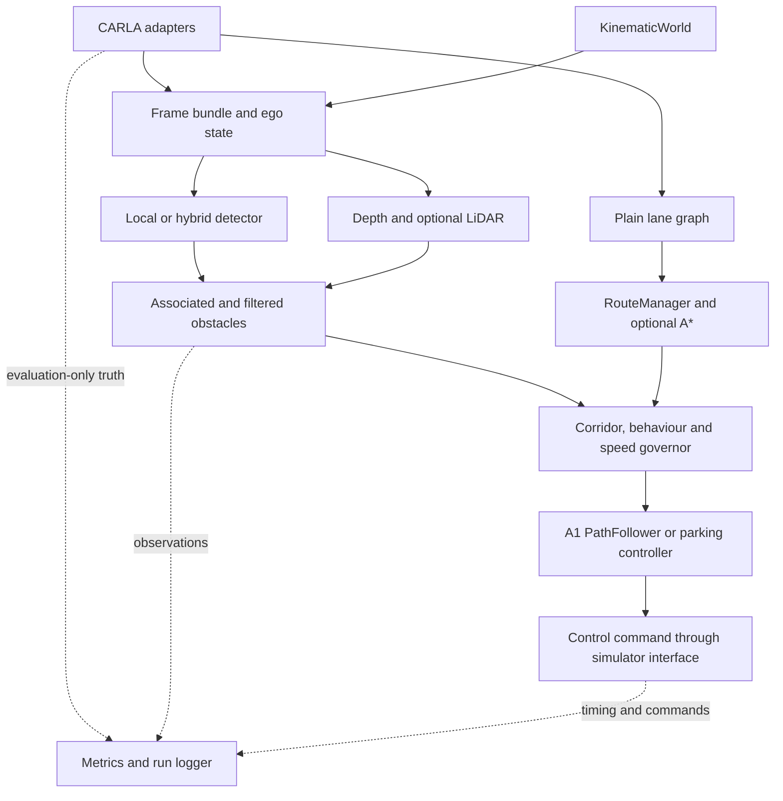

# ELEC5308 Assignment 2 — Group 7 master plan

Prepared 9 October 2026. Delivery window: **Monday 12 October–Sunday 1 November**, Australia/Sydney. Internal submission readiness: **31 October**. Status: **proposed allocation for team review; implementation and simulator acceptance are not yet complete**.

This plan follows the supplied `A2_project_prompt.md`, the three-page Assignment 2 brief and the supplied A1 source archive, in that order of reading. For requirements, the assignment and confirmed teaching-team scope take precedence. The user's latest confirmation establishes **four CARLA-capable owners: Mohammad, Abdullah, Alan and Zhaolin**. Previous planning files were not substituted for these attachments.

## 1. Purpose and delivery scope

Deliver a reproducible, offline CARLA system that extends the A1 library: follow one legal continuous route in Town10HD, detect stationary vehicles and pedestrians, stop with a measured margin, hold while blocked, then resume after verified clearance. The system must be explainable by all six members and supported by raw runs, tests, documentation and a backup video.

**A working release means:** a fresh clone with documented prerequisites and actual model weights can execute the baseline command on the selected laptop; all applicable S0–S5 criteria pass; failure paths stop safely; an eight-minute demonstration is rehearsed; the repository, report and evidence agree on what is implemented.

Three weeks is a credible target for this reduced baseline with the proposed availability. Completing every stretch feature to the same standard is an aggressive target, not a promise. The task board schedules all five extension workstreams, while admission gates protect delivery of the required system.

| Scope | Delivery treatment |
|---|---|
| Mandatory baseline | Continuous fixed route, calibrated A1 controller, RGB-D object association, route corridor, speed governor, stop/hold/resume, fault stop, deterministic scenarios and metrics |
| A1 revamp | Preserve public APIs; reconcile duplicate lane implementations; improve detector lifecycle, traffic distance, optional segmentation, adapter boundary, docs, CI and scripts |
| E1 weather | Three conditions; S0–S2 × 3 repetitions per condition; perception and system measurements |
| E2 LiDAR | Vehicle-frame points, ground removal, corridor clusters, shared obstacle interface, L1 unknown-to-YOLO prop |
| E3 Wayfinder v1 | Own A* on exported lane graph, named destinations, continuous route, mini-map, five legal origin–destination pairs; no lane changes |
| E4 hybrid v1 | Local Docker inference server, isolated tracking sessions, nonblocking client, concurrent local fallback, latency and outage evidence; external cloud conditional on account/budget |
| E5 parking v1 | Forward-in bay parking and measured final pose; reverse parking is a separate P2 experiment with its own admission tests |
| Conditional/future | Click-to-map destination refinement, lane changes, obstacle passing, blocked-edge reroute, remote Wayfinder endpoint, moving traffic and traffic-light compliance |

E1 → E2 → E3 → E4 → E5 is the default priority from the prompt. A P0 baseline failure takes time from P2 first, then P1. Within an extension, preserve its smallest demonstrable version before adding UI or v2 work. No failed extension enters the live configuration merely because its code exists. Incomplete work may be shown as clearly labelled replay/harness evidence.

Traffic lights along the mission are held green by scenario setup. No background traffic is used. Starting cruise candidate is 5 m/s; measured stopping and detection performance may justify a lower value at G1. Map topology and simulator ego pose are proposed navigation inputs, explicitly subject to tutor confirmation. **Obstacle actor poses, boxes and light states never feed the obstacle-control decision.**

## 2. Requirements traceability

Labels used throughout: **Requirement** = assignment/feedback; **Team input** = supplied project prompt or latest user statement; **Recommendation** = this proposed implementation detail; **Unresolved** = confirmation/evidence still needed.

| Source and requirement | Where delivered | Task/evidence |
|---|---|---|
| Brief pp.1–2: extend A1 with meaningful advanced capability | Route planning and perception-driven obstacle behaviour around retained A1 APIs | BL-A-03, BL-D-08, BL-F-06, G2-01 |
| Brief p.2: GitHub.com A2 repository, runnable instructions and tests/examples | A2 repository, setup script, README, CI, scenario CLI | PROC-01, DOC-03, DOC-08, TEST-12 |
| Brief p.2: scope must remain consistent with confirmed proposal | Reduced scope first; request extension/pose/map clarification in Week 1 | PROC-03, decision log |
| Feedback via prompt §1.1: specify depth and association | Exact-frame RGB-D geometry, track filtering, corridor footprints | BL-D-01–04, BL-C-04/06, BL-B-02/04 |
| Feedback: CARLA dependencies inside adapters | Plain interfaces, adapter-only CARLA queries, banned import and import test | BL-F-01, RV-05, BL-A-02 |
| Feedback: repeatable completion/collision/margin/speed/latency scenarios | S0–S5 with five trials each; per-run metrics and frozen definitions | BL-D-06, TEST-04–10, G3-01 |
| Brief p.2: technical PDF with four named sections and length cap | Scope/rationale, extension, design decisions, evidence/limitations | DOC-01/02/04/06/07/09/10 |
| Brief pp.2–3: 8-minute demo + 2-minute Q&A, all members present | Named speakers, cross-training and two complete rehearsals | DEMO-01–04, COM-*, DEMO-*-R* |
| Brief p.3: own laptop, backup video submitted to Canvas | Primary/backup machine and locally playable video | PROC-02, TEST-12/21, DEMO-02 |
| Brief p.3: private self-reflection, ≤1 page/400 words | Six private readiness tasks covering contributions, learning and AI use | IND-*-REF |
| Brief p.3: peer reflection for at least two other teams | Prepare forms; complete at actual Week 13 lab | IND-*-PEER |
| Brief p.3: SparkPLUS, deadline cannot be extended | Six deadline verification/reminder tasks; private submission at actual deadline | IND-*-SPARK |
| Brief p.3: significant AI interactions in VSCode AI Journal; disclose in commits and reflection | Weekly private checks and PR/commit templates | IND-*-AI*, `.github/pull_request_template.md` |
| Team input: retain algorithms, configuration, safe failure, offline default and evidence | Architecture/contracts/calibration, model manifest, fault suite | BL-E-01–03, BL-F-02/05, TEST-13/15/16/22 |
| Latest user: four named members have CARLA | All `CARLA Required=Y` tasks assigned only to those members | Team sheet; importer schedule validation |

The supplied PDF does not provide the final report date or exact Week 13 lab slot. Its proposal date is historical; PROC-03 confirms the existing approved proposal and requests changes, rather than scheduling a new September submission. There are no numeric marking weights in the supplied brief, so none are invented here.

## 3. Architecture, reuse and interfaces

### Source audit that changes this plan

| Observed in supplied A1 source | Consequence |
|---|---|
| `navigation_control/controller.py` already takes rear-axle state, clamps speed near an open-path endpoint and resets PID on `set_path` | Retain controller; set one continuous path at mission start; do not reset every camera frame or mutate private PID state |
| Fused demo passes `wheelbase_m=2.5`, steering limit `0.6`, centre pose via default offset and that same limit into steering conversion | Read/verify actual vehicle geometry and actuator response before tuning; no universal 70-degree assumption |
| Demo uses wall-clock dt, repeated local path replacement, `sleep(DT_S)` and last-command/creep fallbacks | Synchronous fixed dt, frame-age logging and explicit fault stop |
| `turn_decision.py` returns the first branch fan-out and can join two waypoints with a direct segment | Follow each candidate to the junction exit; export a continuous lane-centre polyline through the turn |
| `VehicleState` rejects negative speed; `PathFollower` says forward-only | Add a separate signed `MotionState` and reverse controller; do not silently change A1 semantics |
| `ReferencePath.project` returns unsigned distance and scans all segments | Add route-tangent signed lateral projection; use an open non-self-crossing baseline route to prevent ambiguous progress |
| `ObjectDetector.track` hardcodes `botsort.yaml`, persists history and has no public reset | Add reset/config/timing protocol and track-session tests |
| Traffic and general perception have separate box types | Use compatibility adapters around one validated internal representation |
| Three lane files exist in two package trees; two pairs differ | Reconcile behaviour before deleting code; keep compatibility import shims |
| `lane_unet_best.pth` is a 133-byte LFS pointer; `segmentation_model.pth` is a 132-byte pointer | Day 1 asset recovery is a real prerequisite; archive alone cannot run those models |
| `yolo26n.pt` contains 5,544,453 bytes; no `.git` history in ZIP | Verify checksum/load/provenance; do not infer commit authors or current A2 repository state |
| CI defines Ruff, pytest and Sphinx; 62 test functions found, some parametrized | README's 106-test claim is not treated as a fresh result. Run the real suite on the selected environment |

The supplied 0.22 m and 1.14 m kinematic comparison figures were **not reproduced in this review**. The source supports investigating the listed integration defects; it does not prove those numerical results or a causal two-times steering error for every blueprint.



HUD subscribes to diagnostics; it does not own control state. Runtime entry points construct adapters, while all simulator calls/conversions remain in `carla_adapter/`. CLI scripts delegate to adapter services. Archived examples retain wrappers without spreading CARLA calls into core packages.

| Module | Reuse and planned work | Baseline owner |
|---|---|---|
| `perception/` | A1 object detector and canonical lane files; reset, protocol, timing, tracker config | Ricky; Abdullah for lanes |
| `navigation_control/` | Retain forward controller, PID, path and public types; separate parking/reverse additions | Zhaolin |
| `traffic_perception/` | Retain traffic API; adapt boxes and primary depth distance; fallback remains labelled | Alan |
| `segmentation/` | Retain BiSeNetV2 wrapper; optional depth-ROI masking and controlled cadence | Mohammad |
| `geometry/` | Move ground projection; camera model and explicit rigid transforms | Alan |
| `obstacle_perception/` | New depth association, typed obstacles, track filter and optional LiDAR source | Ricky / Alan / Mohammad |
| `planning/` | New continuous route, corrected junction planner, corridor, governor, behaviour; optional A*/parking | Zhaolin / Alan / Abdullah |
| `autonomy/` | New contracts, stack, timing and safety arbitration | Saviour; Abdullah integrates CARLA |
| `carla_adapter/` | Split existing adapter into world, vehicle, sensors, topology, scenario, truth and CarlaWorld | Abdullah / Mohammad |
| `sim_harness/` | New kinematic world and synthetic observations; CI uses same stack | Saviour |
| `evaluation/` | Run schema, scenario runner, metrics and plots | Saviour; CARLA owners produce logs |
| `cloud/` | Optional server and remote/hybrid detectors | Ricky / Saviour |
| `visualisation/` | Move overlays; lane monitor, state, distance, speed, mini-map and backend status | Abdullah |

### Contracts to freeze at G0

| Contract | Required content and semantics |
|---|---|
| `SimulatorInterface` | `reset(config)`, `observe()`/bounded tick lifecycle, `apply(command)`, `close()`; one tick owner; plain outputs; no actor handles |
| `FrameBundle` | run ID, frame ID, simulation timestamp, host receive/tick timestamps, RGB uint8 H×W×3, depth metres H×W, intrinsics/extrinsics, ego snapshot of that frame, per-sensor validity; optional LiDAR |
| `Detector` | Preserve local `detect`/`track`; protocol adds episode `reset`, timing and observation metadata; local/remote fakes share contract |
| `Obstacle` | source, namespaced track/session ID, class/confidence, frame/time, vehicle/world footprint, route longitudinal/lateral interval, uncertainty, confirmation and validity |
| `ObstacleSource` | Return observations plus coverage/health; no detections and invalid observation are different outcomes |
| `ControlCommand` | Existing positive-left radians and mutually exclusive throttle/brake; adapter owns sign/normalization and gear |
| `MotionState` | New signed-speed type for reverse experiments; convert to existing forward state only in DRIVE when valid |
| `Graph` / `Mission` | Serializable legal lane successors/polylines; initial pose, maneuver list, destination and map/hash; no `carla.Waypoint` in core |
| `Diagnostics` | behaviour/mode, selected source, clear/confirmation counters, target components, actual speed, signed CTE, route progress, timings and fault reason |
| Evaluation packet | Actor boxes/poses, collision/lane events and scenario truth; only evaluation receives this packet |

Extension hooks are part of baseline contracts: detector backend selection, all frame timing fields, sensor-independent obstacles, YAML sensor/weather rig, exported graph, signed motion type and DRIVE/PARK mode slot. All flags default off; the local baseline runs without network access.

## 4. Technical specifications

### 4.1 Navigation repair and calibration

Select a single four-wheel blueprint and keep it fixed across comparisons. Record the full physics configuration. Verify wheel-position units and coordinate frame on the installed build rather than blindly dividing coordinates by 100: the public API documentation describes position differently from radius, and measured geometry is authoritative. Convert front/rear axle centres into vehicle-local metres, check plausible wheelbase and centre-to-rear-axle offset, and retain the calibration snapshot.

Keep a conservative controller steering cap separate from the physical actuator maximum. Initial CARLA steering conversion is `steer = -angle_rad / physical_max_rad`, clamped to [-1,1], then validated against the actual steering curve and yaw response. The constructor default of 70 degrees is not proof of the spawned vehicle's maximum. Do not normalize by the controller's 0.6-rad cap simply because it bounds the controller output.

Measure left/right steady steering at 2, 5 and 8 m/s. Compare measured yaw rate with a bicycle approximation, `delta ≈ atan(L * yaw_rate / speed)`, after converting yaw units and sign. Record discrepancies caused by dynamic tyre effects or speed-dependent steering. At low speed, perform throttle/brake steps and estimate response delay, achievable acceleration and conservative deceleration. Tune PID/lookahead at the selected fixed dt, then run S0 five times. Algorithm changes require evidence beyond integration fixes.

**Owner split:** Abdullah builds/calibrates vehicle translation; Zhaolin validates path/control behaviour. Their review pairing catches sign, reference-point and reset errors.

### 4.2 Continuous mission route

Use a fixed open, non-self-crossing route containing straight and turning sections in Town10HD. Freeze start pose, legal lane sequence, maneuvers and destination after visual map checks. A 100–250 m route is a recommendation for fitting repeats/demo time, not a validated map route supplied here.

`RouteManager` expands the complete maneuver sequence at mission start. `JunctionPlanner` explores legal successors through each junction, classifies exit heading relative to approach heading, selects the requested maneuver and concatenates actual lane-centre samples. Remove duplicate points, reject invalid connectivity and sharp shortcuts across curbs. Do not implement a maneuver by joining its entry and exit with a chord.

Call `PathFollower.set_path` once for the mission. Its endpoint braking is appropriate at the real destination. A temporary zero speed command midway does not finish the route. Replacing the path is reserved for an explicit mission/reroute change with reset semantics. Track progress must not jump to a nearby later segment; the chosen baseline route avoids self-intersection while more general planners require constrained projection.

### 4.3 Depth, association and temporal state

1. Configure colocated RGB and depth cameras with identical resolution/FOV and known lens settings. Match exact frame IDs and the corresponding ego pose. Never use current ego pose to transform an older observation without explicit compensation.
2. Decode CARLA's BGRA bytes into RGB channel values and use `depth_m = 1000*(R + 256*G + 65536*B)/16777215`. Cast before arithmetic to avoid uint8 overflow. Preserve raw depth bytes; visual grayscale/log-depth images are not metric input.
3. Take median valid depth within the detection's inner ROI. Reject empty, nonfinite, saturated, background-dominated or inconsistent samples. Optional same-frame semantic masking can refine the ROI only if the ablation improves distance/false-positive performance at acceptable cost.
4. Establish whether the installed depth representation matches optical-axis depth or ray distance using off-axis test geometry. For optical depth, use `X=(u-cx)*Z/fx`, `Y=(v-cy)*Z/fy`; if ray distance is represented, normalize the camera ray before scaling. Convert optical camera axes to the vehicle frame explicitly.
5. Transform into world coordinates with the capture-time pose. Project a footprint, not just its centre, to the route frame. Determine forward gap from the ego **front bumper** to the nearest obstacle surface along the applicable route corridor. Keep uncertainty margins and camera/axle offsets explicit.
6. Namespace identities by source and episode/session. Per track, apply a short median filter, N-of-M confirmation and unseen timeout. Initial 3-of-5 and three-clear-frame candidates are recommendations to validate against delay and detection range, not frozen final values. Handle missing track IDs and backend switches conservatively.
7. A track expiring is not evidence of free road. Require fresh valid views of the required corridor and multiple clear observations before resume. Occlusion, failed inference, mismatched depth or stale results keep the car stopped. The scenario removes the obstacle; the controller discovers clearance through its perception inputs, not the removal event.

Ground projection and known-width pinhole estimates are flagged fallback measurements with wider uncertainty. Unknown distance never turns an object into “no obstacle.” The 25 m first-confirmed-detection target is tested for both pedestrians and vehicles, including weather and image-size effects.

### 4.4 Behaviour and speed governor

| State | Entry/behaviour | Exit |
|---|---|---|
| CRUISE | No confirmed relevant obstacle; follow curve/cruise caps | Confirmed in-corridor obstacle → APPROACH; invalid critical input → EMERGENCY_STOP |
| APPROACH | Nearest obstacle cap starts controlling speed | Braking/low-speed zone → STOPPING |
| STOPPING | Positive gap and conservative braking toward stop margin | Speed ≤0.1 m/s with stopped-state checks → HOLD |
| HOLD | Throttle zero, hold brake; keep observing; obstacle stays stationary | Valid corridor coverage and clear hysteresis → RESUME |
| RESUME | Rate-limit acceleration, continue same path and progress | Stable movement → CRUISE; new obstacle → APPROACH/STOPPING |
| EMERGENCY_STOP | Invalid state/frame, controller exception, unsafe gap or no valid backend result; command brake and log cause | Explicit reset/acknowledgement after valid-state checks; never reuse last moving command |

Candidates from the prompt are `v_curve = sqrt(a_lat_max / abs(kappa))` and `v_obstacle = sqrt(2*a_dec*max(0,gap-d_stop))`. Straight segments use cruise cap without dividing by zero. Use a curvature lookahead envelope so the car slows before bends, rather than reacting only at the current point.

Calibration must add response delay to the obstacle calculation. A conservative implementation subtracts `v_current*tau` from usable gap before applying the square-root cap, where `tau` includes confirmation, sensing, computation and actuation allowance. The budget to detect and stop is approximately:

`required_gap = v*tau + v²/(2*a_dec) + d_stop + uncertainty_allowance`.

For illustration only, 5 m/s, 0.2 s delay, 1.2 m/s² deceleration and 3.5 m margin need about 14.9 m before additional uncertainty. This is not a calibration result and explains why the prompt's “about 14 m” must be measured. If confirmed detection is too late, lower cruise speed; do not weaken collision/margin thresholds to pass.

Target speed is the minimum cruise, curve, obstacle and controller endpoint caps. Limit acceleration and normal transitions. An emergency stop or newly tighter safety cap must override smoothing immediately. Keep throttle and brake mutually exclusive. `PathFollower` handles longitudinal actuation; the governor selects a safe target.

### 4.5 Simulation timing and reproducibility

Choose 0.10 s initially as a profiling candidate; 0.05 s is available if the complete laptop workload can support it. G1 freezes the step, controller dt, physics substeps and sensor cadence. Only one client advances the world. Handle sensor delivery through bounded queues and frame-indexed ego snapshots. GPU camera delivery can lag; exact-frame pairing is essential and a bounded timeout must not become indefinite blocking.

Distinguish simulation time, frame age and wall time. The course latency metric is wall-clock capture-to-command application. Because a CARLA sensor timestamp is simulation time, record the host tick/request associated with each frame as a documented capture-origin approximation plus host receive/apply times. Report receive-to-apply separately and include frame-age-in-ticks. Do not subtract a simulator timestamp from `perf_counter` or a cloud server clock from a laptop clock.

Synchronous simulation can run slower than real time while remaining stable. Report real-time factor and deadline misses alongside the p95 ≤100 ms goal. A 0.05 s setting has a 50 ms control deadline; meeting 100 ms alone does not establish 20 Hz operation.

Every run writes `runs/<scenario>/<run-id>/` with config snapshot, source git hash/dirty status, dependency/model versions and hashes, hardware, seed, map/blueprint, event log, per-tick JSONL/CSV, summary JSON and selected images/video. Reset trackers and all filter/state histories between runs. Preserve failed attempts. Ground-truth packets are separate from input observations. Restore world settings and destroy only actors owned by that run in `finally`.

### 4.6 Extension specifications and admission

| Feature | Offline implementation | CARLA evidence and definition of done | Cut condition |
|---|---|---|---|
| E1 | Config schema and three-condition dataset/evaluator | S0–S2 × 3 conditions × 3 runs = 27; per-class recall, confirmed detection range, applicable safety/speed/latency metrics; lights at night | Failing conditions described honestly; only validated setting admitted |
| E2 | Ground removal, corridor crop, clustering, confirmation on N×4 float32 points | Proper sensor-to-vehicle transform; `rotation_frequency=1/dt`; L1 succeeds with a verified unrecognized prop; depth/LiDAR/GT distance and compute-cost comparison | Ground false positives or deadline regression |
| E3 | Own A* with nonnegative length cost, admissible Euclidean heuristic, deterministic ties, no-route case | Five reachable legal pairs complete; continuous paths; adapter-only GlobalRoutePlanner length reference; mini-map and maneuver distance | Core graph/route inconsistent or v1 requires lane changes |
| E4 | Docker server, isolated sessions, client, concurrency, deadline/health tests | Same model/config across local/LAN/cloud; latency sweeps; kill-server test; full baseline with hybrid flag on | No fresh local fallback, unsafe ID switches, GPU contention or missed latency budget; keep offline local mode |
| E5 | Forward parking approach, signed-motion hook; separate optional reverse prototype | P1 five runs at ≤0.3 m final position and ≤5° heading, zero collisions, final approach ≤1 m/s; blocked-bay stop; P2 needs its own five trials and baseline regression | P1 instability or missing P2 evidence; reverse is first parking cut |

**Weather details.** The supplied prompt's `ClearNight` name needs checking: it is not listed in the retrieved 0.9.16 API preset section. Use a verified installed preset or an explicit parameter set (including sun altitude) stored under the team's own `clear_night` key. Do not infer physical wet-road braking changes or realistic rain returns from an RGB weather preset. Measure/document the simulator model used for RGB, depth and LiDAR separately.

**Hybrid concurrency.** A serial “wait one period for cloud, then run local” design cannot promise fallback within that period. The proposed design keeps a local result ready concurrently. The HTTP worker has bounded in-flight work, returns frame/run/session IDs and never stalls the control thread. Select remote only when timely and aligned; otherwise use fresh local; if neither is ready, stop. Tracker IDs are not assumed consistent between server and local detector. Reconfirmation and HOLD logic remain conservative across switches.

This concurrency can duplicate compute and may provide no speedup on the same GPU. Benchmark both latency and accuracy before claiming a benefit. Separate client encode/decode, server inference duration, total RTT and client-observable transport timings. Without synchronized clocks/instrumentation, the residual cannot be truthfully split into precise one-way upload and download latency. Record residual network/queue time and label any estimated breakdown. Use ≥200 warm frames per image-size/JPEG-quality condition plus a separate cold-start result, with p50/p95/max/deadline misses. Actual remote cloud results stay NOT RUN until an authorized provider/account exists.

**Parking details.** Define the target reference point (rear axle or vehicle centre) and bay footprint consistently for all errors. Check the entire vehicle swept footprint, not only path points. Validate final heading as well as position: the existing forward controller's endpoint criterion alone is insufficient for precise parking. Gear changes occur only when stopped. Reverse kinematics and steering signs get separate tests and calibration.

All admitted flags must pass S0–S5 independently **and in the selected combined configuration**. Six sets of 30 baseline trials can mean up to 180 extension-regression runs, in addition to the original 30 and extension scenarios. Run them through scripts across four machines; preserve version/config identity and repeat timing on the actual demo laptop. This run volume is a substantial reason to keep routes short and reserve contingency.

## 5. Acceptance scenarios and metric definitions

All baseline trials use the selected Town10HD version, vehicle, sensor rig, fixed seed per replicate and no background traffic. Five repetitions are required per scenario. Keep all attempts, not just the best five. Before final acceptance, freeze the scenario manifests and the final tested commit.

| Scenario | Setup and pass condition | CARLA owner |
|---|---|---|
| S0 | Complete open mission without obstacles or false stops | Zhaolin |
| S1 | Car ahead: stop → hold → scripted removal → perceived clearance → resume → finish | Alan |
| S2 | Stationary pedestrian: same sequence | Alan |
| S3 | Roadside car outside swept ego corridor: no false stop or substantial added slowdown | Mohammad |
| S4 | Persistent obstacle: stop and hold for entire configured interval; recommended 60 s | Mohammad |
| S5 | Stationary obstacle after a bend with a physically achievable sight-distance budget; stop, remove after hold, resume | Abdullah |

**S4 deliberately does not complete the route.** Its completion metric is N/A. This resolves the conflict between a persistent obstacle and a blanket 100% completion rule. S5 must not be configured with an impossible stopping distance; document sight distance and the pre-bend curve cap.

| Metric | Provisional target | Measurement |
|---|---|---|
| Completion | 100% in S0/S1/S2/S3/S5 | Reached route endpoint and stopped correctly; monotonic progress alone is not proof |
| Collisions | 0 every trial | Unique physical contacts, with duplicate sensor-event treatment documented |
| Unplanned lane invasion | 0 every trial | Only explicitly mapped legal maneuvers excluded; log all raw events |
| Stopped margin | 2.5–6.0 m | Ground-truth ego-front to nearest obstacle surface after stopped criterion; worst minimum and maximum across runs |
| Cruise speed error | RMS ≤0.5 m/s | Stable cruise intervals only; compare to active governed target, not 5 m/s during braking |
| Mean cross-track error | ≤0.3 m | Rear-axle distance to continuous path; report per run, signed trace and max as context |
| End-to-end latency | p95 ≤100 ms | Full pipeline with documented host capture-origin convention; record p50/max, missed deadlines and frame age |
| Depth error | Median absolute ≤0.5 m within 25 m | Like-for-like visible surface distance, per range bin with counts and invalid rate |
| False stops S0/S3 | 0 | Suggested operational definition: unexpected target <0.1 m/s for ≥1 s, excluding planned final stop |
| Resume time | Report only | Removal timestamp to resumed motion, with clear counter shown |
| HOLD stability | Suggested ≤0.1 m/s for 60 s | Freeze duration/speed definition at G1 |
| S3 added slowdown | Suggested ≤0.5 m/s | Matched S0 cruise window; curve/goal intervals excluded |

The workbook separates required run count, completed runs and measured result. Blank is not zero. All results start **NOT RUN**. A gate with failed criteria may be documented as blocked/conditional, but must not be reported as a passing baseline. Any threshold change after G1 needs a dated decision, justification and rerun of affected evidence.

## 6. Build stages, gates and critical path

| Date | Gate | Exit and recovery action |
|---|---|---|
| Wed 14 Oct | G0 | Contracts, skeleton, reconciled lanes, adapter smoke, A1 capture, written tutor request. Clear asset/interface blockers before adding features |
| Sun 18 Oct | G1 | Calibrated S0 5/5, range/depth dataset, harness CI, thresholds/dt frozen. If missed, suspend extension coding |
| Wed 21 Oct | G2 | First real perception-driven stationary-car stop in CARLA. Crude stop is evidence of integration, not final acceptance |
| Sun 25 Oct | G3 | S0–S5 pass applicable thresholds, fault tests and timing; one-command regression and immutable baseline tag |
| Wed 28 Oct | G4 | Individual and combined extension regressions; freeze admitted flags and demo configuration |
| Sat 31 Oct | G5 | Report/docs/reproduction/video and two rehearsals complete; private individual readiness checks complete |
| Sun 1 Nov | Buffer | Repair a reproduced release blocker; no planned new feature work |

**Two branches converge on the first stop.** Navigation: contracts → vehicle calibration/topology → continuous route → G1. Perception: contracts → exact-frame RGB-D/dataset → depth geometry and filtering → corridor → behaviour/governor. Both feed harness/CARLA integration → G2 → 30-run baseline and fault suite → G3 → final evidence/report/demo.

The prompt lists maneuver planning as parallel work; it is actually a **G1 prerequisite** for the continuous mission. The board therefore places it on the navigation critical path. Extensions can develop against fixtures before G3 but cannot bypass their integration and regression dependencies.

Tasks are mostly 1–3.5-hour units, no more than a day. Dates are planned execution/finish dates rather than a list of arbitrary final deadlines. A few explicit weekly review/coordination rows spread short sessions through a week. Same-day predecessors are allowed by the requested `Start >= latest dependency due` formula; each such row states that predecessor completion and review must occur first. The dependency graph was checked for missing IDs, cycles and date inversions.

## 7. Workstreams, reviews and workload

| Member | Baseline ownership | Extension ownership | Review partner | CARLA |
|---|---|---|---|---|
| Mohammad | B — aligned sensors, dataset, segmentation and sensor evidence | E2 — LiDAR | Alan | Yes |
| Abdullah | E — vehicle adapter, integration and lane monitor | E3 — Wayfinder | Zhaolin | Yes |
| Ricky | C — detector, association and temporal filtering | E4 — inference server, sessions and model parity | Saviour | No confirmed access |
| Alan | D — depth geometry, corridor and stop behaviour | E1 — weather robustness | Mohammad | Yes |
| Zhaolin | A — continuous route, calibration and retained controller | E5 — parking | Abdullah | Yes |
| Saviour | F — contracts, harness, CI, logging and evaluation | E4 — remote client, failover and latency analysis | Ricky | No confirmed access |

Saviour's A1 role is absent from the supplied module-allocation table; the F assignment is a recommendation based on project needs, not a claim about past work. E4 is intentionally split between two separately owned components because there are six members and five extension headings. Mohammad/Alan and Abdullah/Zhaolin support each other's simulator evidence without leaving ownership ambiguous.

| Member | Week 1 hours | Week 2 hours | Week 3 hours | Total |
|---|---:|---:|---:|---:|
| Mohammad | 25.5 | 23.0 | 21.0 | 69.5 |
| Abdullah | 26.0 | 22.5 | 19.5 | 68.0 |
| Ricky | 27.5 | 22.5 | 20.5 | 70.5 |
| Alan | 25.0 | 22.0 | 22.0 | 69.0 |
| Zhaolin | 28.5 | 22.5 | 23.0 | 74.0 |
| Saviour | 27.0 | 23.0 | 19.5 | 69.5 |
| **Team** | **159.5** | **135.5** | **125.5** | **420.5** |

These include review time (3 h/member/week), coordination/cross-training (1.5 h/member/week), AI checks, report work, both rehearsals and private readiness tasks. There are **223 tasks**. Under the **unconfirmed 32 h/member/week ceiling**, total available time is 576 h and unallocated contingency is 155.5 h. Week 3 deliberately carries lighter committed work because multi-flag regressions, cold starts and report corrections often expose late defects. This reserve is not evidence that every ambitious extension will fit.

At most six hours of single-day task effort are booked per person/day before distributed review/coordination. Confirm availability by 12 October. If the team can provide only 15–20 h/person/week, preserve baseline/report/demo and defer lower-priority extensions. Do not compress task estimates without reducing scope.

Use short feature branches and focused PRs. Each PR has one accountable owner and another reviewer; merge only after relevant tests and linked evidence. Reviews happen before the dependent task starts even though weekly review hours are summarized on the gate date. Coordinate adapter changes through Abdullah/Mohammad and contracts through Saviour to avoid merge conflicts.

## 8. Testing, CI and reproducibility strategy

| Layer | Runs where | What it establishes |
|---|---|---|
| Unit tests | Every member/CI, no CARLA | Units/frames, transforms, box validity, depth encoding, graph legality, controller compatibility, state guards, filters and deadlines |
| Harness integration | Every member/CI | Same stack lifecycle, deterministic route/stop/resume and fault decisions; not proof of tyre dynamics or neural visibility |
| Recorded-data replay | Ricky/Saviour plus any member | Actual detector/segmentation outputs, confirmation range, depth association, source switching and latency with held-out runs |
| CARLA smoke | Four capable owners | Installed-version contracts, blueprint/sensors, signs, scenario cleanup and first-stop integration |
| Baseline acceptance | Four owners; final timing on demo laptop | Five trials each S0–S5 and fault tests; save every run |
| Extension acceptance | Offline first; assigned CARLA owner | Feature-specific criteria, flag-on baseline and combined configuration |
| Fresh clone and rehearsal | Saviour core clone; Alan independent full CARLA clone; whole team demo | Reproduction from instructions and assets, offline startup, readable HUD/video and Q&A ability |

Keep core CI network-independent with fake detectors and small checked-in fixtures. Heavy model/replay evaluation and CARLA tests are explicit separate jobs/commands; do not silently skip an unavailable test and call it a simulator pass. Pin validated dependency versions rather than accepting the unbounded A1 package list. Preserve old public constructors/imports with adapters while refactoring.

Implementation-task verification commands remain:

```bash
ruff check .
python -m pytest
sphinx-build -W docs docs/_build/html
```

CARLA acceptance command is planned as:

```bash
python scripts/run_acceptance_suite.py --backend carla --config configs/release.yaml --runs 5
```

That last command is an intended implementation interface, **not a script delivered by this planning pack**. The delivered working scripts are the workbook exporter and GitHub task importer. Do not confuse the planning pack with the completed autonomous-driving codebase.

The current review environment has no running CARLA, `gh`, PyTorch/OpenCV, pytest, Ruff or Sphinx installation. A1 full execution was not attempted or claimed. Planning checks and GitHub importer tests use the standard library; workbook formulas are checked in Artifact Tool. The validation note in this pack records actual commands/results and these limits.

## 9. Risk register and triggers

| Risk | Likelihood / impact | Mitigation and trigger | Owner |
|---|---|---|---|
| Missing lane/segmentation weights | High / high | Recover LFS objects and prove checksums/model loads on Day 1 | Abdullah / Mohammad |
| Geometry/control still unstable at G1 | Medium / high | Validate coordinate frame/units, steering response and route continuity; stop extension work if S0 fails | Zhaolin |
| Pedestrian detection too late | High / high | Measure first confirmed range, include filter delay, reduce speed if needed | Ricky |
| RGB-D/pose mismatch | Medium / high | Exact frame join, snapshot history, off-axis tests, bounded timeout | Mohammad |
| Track expiry causes unsafe resume | High / high | Valid coverage and clearance hysteresis; hold/occlusion fault tests | Alan |
| Full rig misses deadline | High / high | Full laptop profiling; optional cadence/flag cuts; report slow real-time factor honestly | Abdullah |
| Scope consumes baseline time | High / high | G1/G2/G3 stops; P2 first cut; individual feature and combined admission | Saviour |
| Cloud session/staleness/resource contention | High / high | Concurrent warm local path, bounded worker, namespaced identities, safe stop if both late | Saviour / Ricky |
| Evaluation truth enters control | Medium / high | Separate packets and import/data-flow tests; declare permitted ego pose/map dependency | Alan |
| Laptop/version mismatch | Medium / high | Hardware inventory, dependency/model hashes, fresh clone and backup | Mohammad |
| LiDAR/ROI false positives | Medium / medium | Ground filtering, footprint tests and weather/range ablations before admission | Mohammad |
| Parking breaks forward API or deadline | High / medium | Separate reverse type/controller, P1 before P2, tolerance and regression gates | Zhaolin |
| Course deliverable/deadline omitted | Medium / high | Confirm Canvas dates, six private reminders, PDF limits, video and rehearsals | Saviour |

The workbook contains triggers, related Task IDs and specific fallback/cut actions for each risk. A limitation explains a failed result; it does not convert it into a pass.

## 10. Literature and primary-reference decisions

**No research papers or additional course templates were attached**, including inside the ZIP. The references below are suggested primary reading retrieved for this plan; they are not presented as supplied literature or as evidence that the system already works. Replace/add the course's intended papers when available.

| Primary source | Design use | Evidence the team must still produce |
|---|---|---|
| R. C. Coulter, *Implementation of the Pure Pursuit Path Tracking Algorithm*, CMU-RI-TR-92-01 (1992), [CMU publication](https://publications.ri.cmu.edu/implementation-of-the-pure-pursuit-path-tracking-algorithm) | Understand geometric tracking and lookahead; retain A1 implementation until measured evidence demands a change | Vehicle-specific calibration and S0/A1 comparison |
| Aharon, Orfaig and Bobrovsky, *BoT-SORT: Robust Associations Multi-Pedestrian Tracking* (2022), [arXiv:2206.14651](https://arxiv.org/abs/2206.14651) | Motivate temporal identity association; do not confuse image track ID with collision-free 3D localization | ID flicker/expiry/source-switch tests on captured CARLA sequences |
| [Ultralytics tracking documentation](https://docs.ultralytics.com/modes/track/) | Check installed tracker configuration/lifecycle and persistence conventions | Explicit reset and session isolation tests for installed version |
| [CARLA 0.9.16 sensors](https://carla.readthedocs.io/en/0.9.16/ref_sensors/) | RGB-D encoding/frame metadata and LiDAR rotation/point attributes | Exact-frame capture, depth convention and sensor-to-vehicle transform checks |
| [CARLA synchrony and time-step](https://carla.readthedocs.io/en/0.9.16/adv_synchrony_timestep/) | Fixed-step synchronous design and attention to camera delivery delay | End-to-end timing, wall/sim clock separation and cleanup tests |
| [CARLA 0.9.16 Python API](https://carla.readthedocs.io/en/0.9.16/python_api/) | Inspect physical steering/vehicle/weather fields rather than assuming a constant blueprint configuration | Runtime wheel-position unit/frame sanity test; installed night-weather configuration |
| [GitHub CLI `gh api`](https://cli.github.com/manual/gh_api), [milestones API](https://docs.github.com/en/rest/issues/milestones), [issues API](https://docs.github.com/en/rest/issues/issues), [labels API](https://docs.github.com/en/rest/issues/labels) | Structured JSON requests, paginated all-state issue lookup and due-dated milestone import | Standard-library importer tests now; authenticated import into supplied A2 repo later |

The architecture, stopping-delay margin, capacity estimates and cut decisions are engineering recommendations inferred from the source audit and project constraints. They are not empirical conclusions from the cited papers. A* is implemented and tested against a shortest-path reference; no attached A* paper is claimed.

## 11. Report evidence and demo run-of-show

### Report plan

Use the conservative interpretation of **both ≤3 pages and ≤1,000 words**, excluding references, figures and captions as stated in the brief. Target 900–950 words so edits have room. Confirm if teaching staff interpret “or” differently. Keep API/code explanation in generated docs.

| Required report section | Suggested words | Claim and evidence | Lead |
|---|---:|---|---|
| Scope and rationale | 150 | Reduced route/obstacle scope, intended advanced capability, constraints and tutor confirmation | Ricky, with Alan scope record |
| Extension | 200 | A1 reuse/refactor inventory, continuous path and perception-to-behaviour integration | Ricky, with all module owners |
| Design decisions | 250 | Geometry/sync/depth/corridor choices, considered alternatives, selected extensions | Alan, with Zhaolin/Abdullah |
| Evidence and limitations | 300–350 | All baseline trial counts, CTE/stop/latency/depth results, chosen extension evidence and failures | Ricky compiles; Saviour audits |

Recommended compact figures: architecture; matched A1/A2 CTE trace; S1/S2 distance-speed-state timeline; a small acceptance table with n and worst values. Add only the most informative extension plot if space allows. Every figure caption names scenario, configuration, commit and units; full tables/raw traces live in repository docs. DOC-10 is independent claim checking against actual run data.

### Eight-minute demonstration

| Time | Action | Speaker/operator |
|---|---|---|
| 0:00–0:40 | State approved scope, offline setup and visible architecture | Saviour |
| 0:40–1:30 | Start fixed route; explain rear-axle/steering calibration and continuous path | Abdullah operates, Zhaolin explains |
| 1:30–3:10 | Show car stop/hold/removal/resume with state, distance and target speed on HUD | Alan; Ricky explains detection/confirmation |
| 3:10–4:10 | Show pedestrian sequence or a short prepared scenario switch; identify correct margin | Ricky / Alan |
| 4:10–5:00 | Demonstrate source outputs and selected LiDAR/weather result | Mohammad |
| 5:00–6:10 | Show the strongest admitted extension; Wayfinder/parking live only if reliable, cloud outage via local service or short captured clip | Abdullah / Zhaolin / Saviour |
| 6:10–7:20 | Present acceptance count/table, latency and A1 comparison; explain one limitation | Saviour with evidence owner |
| 7:20–8:00 | Show reproducible command, release configuration and conclude at eight minutes | Mohammad |
| 8:00–10:00 | Random member Q&A on any module | All six |

This is a rehearsal script, not a claim that both missions already fit the allocated time. Choose a short validated route and rehearse scenario resets. Do not try to squeeze every extension into the live segment. Keep the complete baseline proof and use concise evidence for the remaining features. On a live failure, switch to the locally stored backup video using the practised runbook; the report/repository remain consistent with that video.

Each member attends both 30/31 October rehearsals and the actual Week 13 lab. Cross-training covers inputs/outputs, one failure mode, one design alternative and one test for every module. Questions include frame alignment, why a lost track is not clearance, controller endpoint braking, map/ground-truth boundaries and honest cloud timing.

## 12. Decisions, marking requirements and delivery workflow

| Decision | Status / rationale | Revisit |
|---|---|---|
| Four CARLA owners | Confirmed by user on 9 Oct | If access changes |
| One fixed low-speed route, stationary obstacles, stop/resume | Teaching feedback relayed by prompt | Only with tutor-approved change |
| Keep A1 controller; repair integration | Team input supported by source audit | Calibration evidence at G1 |
| Map route and simulator ego localization; actor truth evaluation-only | Proposed explicit interpretation | Tutor response in Week 1 |
| Full baseline before extension admission | Prompt gate model, enforced in allocation | If a baseline gate is missed |
| Capacity 32 h/member/week | Unconfirmed planning assumption | 12 Oct team check |
| Saviour owns F; E4 split server/client | Proposed allocation; A1 role unknown | Confirm prior role/availability |
| Local Docker default; external cloud optional | Team input; provider/account not supplied | E4-08, no cost commitment assumed |
| Report kept within both length limits | Conservative interpretation | Tutor/Canvas confirmation |
| No live GitHub import during preparation | Repository and five handles unknown; files are reviewable first | User/team chooses target and runs importer |

Team review must record date, participating members, confirmed/revised allocations, remaining questions and next review gate. Do not label this draft as unanimously agreed before that review. The A1 `ASSIGNMENT_GUIDE.md` encourages team ownership of decisions; the current request explicitly authorizes producing this draft with labelled assumptions.

`docs/task-board.xlsx` is the editable task source. Export it with `scripts/github/export_workbook.py`, then run `scripts/github/import_tasks.py --repo OWNER/REPO --dry-run`. The importer creates missing labels, six milestones and one issue per task, writes issue numbers back to the CSV, then resolves dependency links. It checks open and closed issues by Task ID and preserves manual notes. Existing issue metadata is not silently rewritten. The importer does not create a GitHub Project or native dependency edges; those are optional later work requiring relevant project/repository permissions.

The task workbook has the requested nine sheets plus an inspectable **Dependencies** helper sheet so comma-separated dependency edits drive live checks. Workload excludes `Cut`, includes `Done` as consumed effort and highlights allocations exceeding editable capacity. Gantt bars and date/gate checks are formula-driven. Metric values are blank until measured; all six gate decisions start “Not reviewed.” Changing dates is not an automatic resource reschedule.

AI-assisted commits use the supplied footer with the real person's name:

```text
AI-assisted: <tool> – <what>; reviewed and edited by <name>
```

The private AI Journal must record significant interactions during work, not merely a final statement. Weekly checks are reminders. Self-reflections and SparkPLUS/peer assessment contents are never stored in team issues. Readiness dates do not replace official submissions. The provided brief says missing SparkPLUS can yield zero for that component, with no extension; each member verifies their own deadline and submission.

## 13. Assumptions and questions that could change allocation

1. **Calendar:** project starts 12 October; 31 October is an internal readiness target and 1 November contingency. Official report, video, individual and SparkPLUS dates and the lab slot are unconfirmed.
2. **Availability:** each member can provide up to 32 h/week including review. Scheduled work ranges from 19.5 to 28.5 h/week. Confirm exams, jobs and unavailable days before accepting the estimate.
3. **Machines:** the four named members have CARLA access; actual GPU performance, version compatibility and primary/backup demo laptops still require a smoke test.
4. **Identity/ownership:** Mohammad's supplied GitHub handle is `kkaaman`; the other five handles and Saviour's A1 role are unknown. No accounts were guessed.
5. **Repository/assets:** the A2 URL and current source history are not supplied. The ZIP is the inspected snapshot. Actual lane/segmentation LFS weights must be recovered; their pointers are not usable checkpoints.
6. **Scope:** baseline completion is the release target. All five v1 extension streams are scheduled, but admission depends on evidence. P2 reverse and v2 ideas may be cut. Tutor approval of these extensions is not assumed.
7. **Localization:** map topology and simulator ego pose may support navigation; this limitation must be approved and stated. Ground-truth obstacle information only measures results.
8. **Physics/sensors:** wheel units/frame, steering response, depth convention, night settings and weather effects are verified on the installed build. No hardware-specific constants are treated as universal.
9. **Numbers:** prompt comparison errors and stopping-distance estimate are unverified supplied figures. Speed, thresholds and delay budget become fixed only after G1 measurement.
10. **External services:** authorized cloud provider, account, budget and endpoint do not exist in the supplied information. Local Docker is the scheduled default; missing cloud measurements remain NOT RUN.
11. **Literature:** no research papers/course templates were supplied; the literature section is a proposed primary-source reading list.
12. **Scheduling:** most rows are single-day tasks; weekly REV/COM reservations are spread sessions. Equal-date dependencies require a reviewed handoff. Eight dependency IDs per row are supported by workbook checks; larger lists need helper expansion.
13. **Deliverable status:** this pack implements planning/export/import tooling. It does not claim the CARLA codebase or acceptance runs are complete. Full application implementation proceeds task by task, as requested in the project prompt.

The most consequential answers now are: **How many hours can each member actually commit each week? Which laptop will run the demo? What was Saviour's A1 role?** Next are the A2 repository URL/five handles, actual course deadlines and whether the tutor accepts map/ego-pose navigation plus the extension list. These answers can revise the existing workbook without discarding its Task IDs or issue history.
